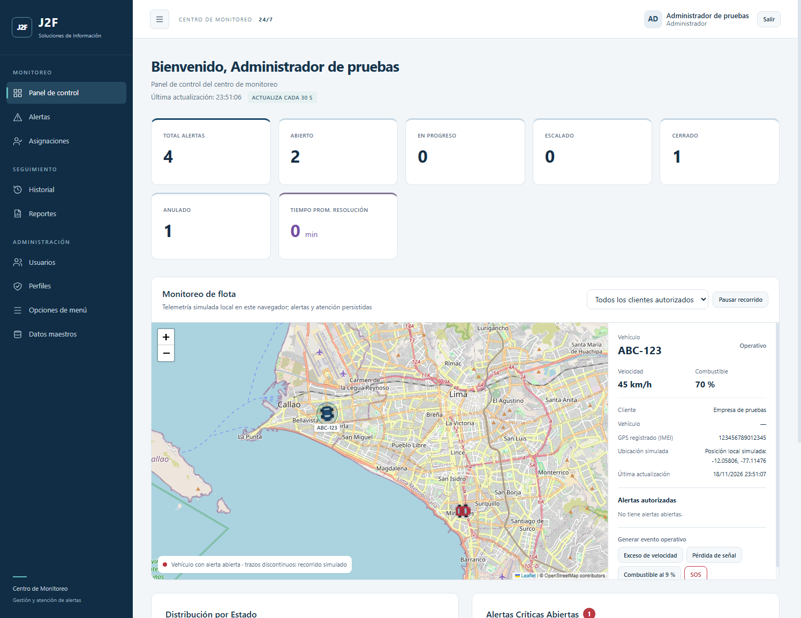

# J2F Monitoreo

J2F Monitoreo permite a un equipo registrar alertas de flota, asignarlas a técnicos y seguir cada atención hasta su cierre. El tablero muestra vehículos con telemetría simulada y conserva en PostgreSQL las asignaciones, las notas y el historial de cada caso.



Angular y Leaflet presentan el mapa. Flask autentica las solicitudes y las funciones de PostgreSQL comprueban los permisos, las transiciones de estado y las reglas de abastecimiento.

## Ejecutar en Windows con Neon

Se requiere Python 3.11 o posterior. Desde la raíz del repositorio, ejecuta:

```powershell
.\scripts\preparar-local.ps1
```

El script instala las dependencias de Python y Angular, descarga Node para el proyecto y prepara `.env.local` con claves de sesión privadas. En ese archivo, reemplaza el valor de `DATABASE_URL` por la cadena de conexión PostgreSQL de tu proyecto en Neon. Conserva los parámetros TLS de la URL.

```powershell
.\scripts\iniciar-local.ps1 -OpenBrowser
# Al terminar
.\scripts\detener-local.ps1
```

El frontend escucha en <http://127.0.0.1:4200> y envía las peticiones de `/api` a Flask a través del proxy de desarrollo. Puedes comprobar la conexión del backend en <http://127.0.0.1:5000/api/catalogs>. Inicia sesión con un usuario registrado en esa base. Al usar una base compartida con el esquema instalado, el arranque conserva los registros existentes.

## Base de datos

Los archivos de `database/` se aplican en orden: `01_esquema.sql` crea las tablas de una base vacía, `02_catalogos.sql` configura permisos, estados, menús y parámetros, y `03_funciones.sql` instala las funciones que usa la API. La telemetría del mapa se simula en cada navegador. La consulta de estaciones y de rutas usa Overpass y OSRM.

Para instalar desde una terminal con `DATABASE_URL` definida, usa `python init_db.py` desde `backend/` **solo en una base vacía**. Para actualizar una instalación compatible con las tablas existentes, usa `python init_db.py --existing`. Para crear el primer administrador en una instalación sin usuarios, usa `python create_admin.py`.

### Importación manual de COOLBOX

En una base existente, aplica `database/08_importacion_clientes_coolbox.sql` en el esquema de J2F. Registra los intentos en `coolbox_import_batches` y las filas recibidas en `coolbox_client_staging`. El maestro se actualiza al recibir la última página. Un fallo del proveedor queda en el lote y conserva intactas las fichas locales.

Configura `COOLBOX_API_KEY` en el archivo privado `.env.local` para uso local o en **Render → j2f-backend → Environment** para el despliegue. Reinicia Flask después de guardar. El endpoint de COOLBOX tiene el valor predeterminado de `.env.example`; usa `COOLBOX_API_URL` si el equipo cambia de dirección.

En **Datos maestros → Clientes**, un perfil con permiso de administración puede pulsar **Importar clientes de COOLBOX**. El resultado indica los nuevos, actualizados, sin cambios y rechazados, con la página y el motivo de cada rechazo. Un documento de otro tipo con el mismo número requiere revisión. Repetir la importación con los mismos datos deja el maestro igual.

### Consulta de clientes desde COOLBOX

Para habilitar la lectura desde el backend de COOLBOX, aplica `database/09_consulta_clientes_integracion.sql` y configura `J2F_CLIENTS_API_KEY` en Flask con una clave aleatoria propia de al menos 32 caracteres. COOLBOX envía esa clave en el encabezado `X-API-Key` de `GET /api/clients/`. La respuesta contiene el tipo y número de documento, nombre o razón social, teléfono, correo y dirección. Para revocar el acceso, retira esa variable y reinicia Flask.

## Pruebas

En `backend/`, instala `requirements-dev.txt` y define `J2F_TEST_DATABASE_URL` con una **base PostgreSQL exclusiva para pruebas** cuyo nombre termine en `_test`. La suite recrea el esquema público de esa base.

```powershell
python -m pytest tests -q
```

En `frontend/`, con las dependencias instaladas:

```powershell
npm test
npm run typecheck
npm run build
```

Para desplegar el frontend compilado, configura el servidor web para servir Angular y redirigir `/api` a Flask. En producción, el backend requiere `DATABASE_URL` y dos claves privadas distintas de al menos 32 caracteres, `SECRET_KEY` y `JWT_SECRET_KEY`.

## Despliegue de la demo

- **Emisor Laravel en Render.** Construir con Docker, contexto `scripts` y archivo `scripts/Dockerfile.fact-api` (rutas desde la raíz del repositorio). La imagen usa Apache en el puerto 80 y aplica el parche de SUNAT beta a la revisión de Laravel probada. Configurar `APP_KEY` de forma privada. Para trasladar el emisor SQLite, restaurar su base en almacenamiento persistente, configurar `DB_CONNECTION=sqlite` y `DB_DATABASE` con su ruta absoluta, y conservar también `storage/app` (XML, PDF, CDR y certificado privado). Los directorios deben ser escribibles por el usuario de Apache. Si se usa un solo volumen, colocar la base en la zona privada de ese volumen. Las migraciones de Laravel usan exclusivamente la base del emisor.
- **Flask en Render.** Seleccionar Python y la raíz `backend`. Construir con `pip install -r requirements-render.txt` e iniciar con `gunicorn --bind 0.0.0.0:$PORT --timeout 120 run:app`. Configurar `FLASK_ENV=production`, `DATABASE_URL` de Neon, `SECRET_KEY` y `JWT_SECRET_KEY` independientes, `CORS_ORIGINS` con el origen de Vercel y las variables `FACT_API_*` de la plantilla. Usar la URL HTTPS del emisor y un token vigente. Revisar el traslado de facturas anteriores: Flask valida la identidad del emisor, incluida su URL, antes de servir documentos.
- **Angular en Vercel.** Elegir `frontend` como Root Directory, Node 22 compatible con `package.json` y definir `J2F_BACKEND_ORIGIN` con el origen HTTPS de Flask. La compilación incorpora esa dirección pública. Los tokens y certificados se configuran únicamente en los servicios que los utilizan.
- **Comprobación.** Abrir la web desde otro equipo, iniciar sesión, consultar una factura anterior y abrir su PDF. Emitir un comprobante de prueba y verificar su PDF, XML y estado. Repetir la consulta tras reiniciar el emisor para comprobar la persistencia.
